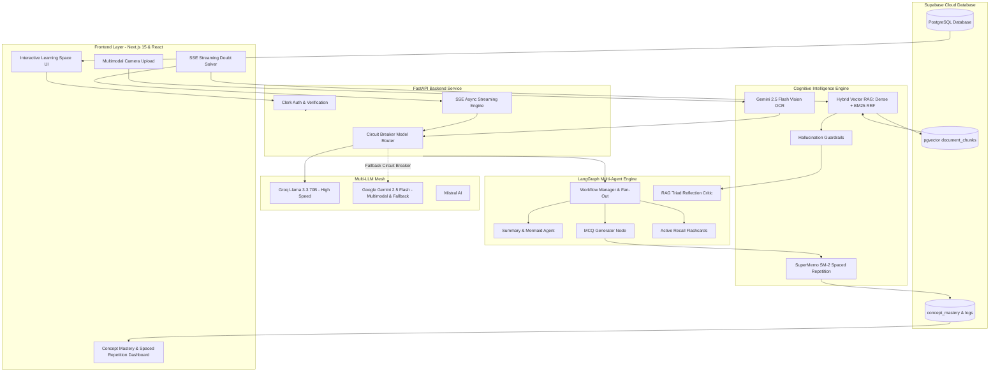

<div align="center">

# 🎓 SmartTutorAI
### *The Next-Generation Agentic AI Learning & Cognitive Mastery Platform*

[](https://smart-tutor-ai-tan.vercel.app/)
[](https://github.com/Aditya16703/SmartTutorAI/stargazers)
[](https://github.com/Aditya16703/SmartTutorAI/network/members)
[](https://opensource.org/licenses/MIT)
[](https://nextjs.org/)
[](https://fastapi.tiangolo.com/)
[](https://langchain-ai.github.io/langgraph/)
[](https://supabase.com/)
[](https://groq.com/)
[](https://deepmind.google/technologies/gemini/)

<p align="center">
  <b>SmartTutorAI</b> transforms raw study notes, uploaded PDFs, textbooks, and YouTube video lectures into an immersive, multi-agent cognitive workspace. Engineered with <b>Hybrid Vector RAG</b>, <b>real-time SSE token streaming</b>, <b>RAG Triad hallucination guardrails</b>, <b>SuperMemo SM-2 spaced repetition</b>, and <b>multimodal vision homework solving</b>.
</p>

[🚀 Live Demo](https://smart-tutor-ai-tan.vercel.app/) • [Explore Features](#-core-architectural-pillars) • [System Architecture](#-system-architecture) • [Quickstart](#-quickstart--local-setup) • [Deploy on Vercel & Render](#-production-deployment) • [API Specs](#-api-endpoints)

</div>

---

## 🌟 Why SmartTutorAI?

Most educational tools rely on standard chatbots that hallucinate formulas, give away final answers passively, and fail to track long-term retention. 

**SmartTutorAI bridges the gap between raw LLM generation and cognitive science:**

- 📚 **No Hallucinations**: Grounded in your uploaded material with exact PDF page citations and deep-linked YouTube video timestamps.
- 🏛️ **True Socratic Mentorship**: Guides students through progressive intellectual hints rather than spoon-feeding answers.
- 📐 **First-Class STEM Rigor**: Native KaTeX rendering for math equations, calculus integrals, chemical structures, and physics proofs.
- 🧠 **Cognitive Durability**: Employs the SuperMemo SM-2 spaced repetition algorithm and AI misconception diagnostics to guarantee long-term mastery.
- ⚡ **Ultra-Low Latency**: Multi-LLM routing engine with a circuit breaker pattern that pairs Groq's Llama 3.3 (70B) with Gemini 2.5 Flash.

---

## ⚡ Core Architectural Pillars

<table>
  <tr>
    <td width="50%">
      <h3>1. 🔍 Hybrid Vector RAG with Citations</h3>
      Combines <b>dense vector embeddings</b> (OpenAI/Gemini) with <b>BM25 keyword search</b> using <b>Reciprocal Rank Fusion (RRF)</b>. Every answer includes interactive citation badges linked to exact PDF page numbers and timestamped YouTube video intervals.
    </td>
    <td width="50%">
      <h3>2. ⚡ Real-Time SSE Token Streaming</h3>
      Ultra-responsive <b>Server-Sent Events (SSE)</b> token streaming via FastAPI. Students get instantaneous visual typing feedback with sub-200ms TTFT (Time-To-First-Token).
    </td>
  </tr>
  <tr>
    <td width="50%">
      <h3>3. 🛡️ RAG Triad Anti-Hallucination Critic</h3>
      Implements TruLens-grade <b>RAG Triad Guardrails</b>:
      <ul>
        <li><b>Context Relevance</b> (Did retrieval match query?)</li>
        <li><b>Groundedness Score</b> (Are all claims supported?)</li>
        <li><b>Answer Relevance</b> (Does it solve the doubt?)</li>
      </ul>
      Renders live trust badges (<i>Verified Grounded 96%</i>).
    </td>
    <td width="50%">
      <h3>4. 📐 Native KaTeX LaTeX Rendering</h3>
      Full typography support for inline (<code>$E=mc^2$</code>) and display equations (<code>$$\int f(x)dx$$</code>). Includes interactive code headers with one-click copy, syntax highlighting, and dark-mode styling.
    </td>
  </tr>
  <tr>
    <td width="50%">
      <h3>5. 🏛️ Socratic 3-Tier Progressive Scaffolding</h3>
      Toggle between <b>Direct</b> and <b>Socratic Mode</b>. Features an adaptive 3-tier scaffolding bar:
      <ul>
        <li>🥉 <b>Tier 1: Nudge</b> (Conceptual hint without formula)</li>
        <li>🥈 <b>Tier 2: Clue</b> (Core formula & tactical setup)</li>
        <li>🥇 <b>Tier 3: Solution</b> (Full step-by-step proof)</li>
      </ul>
    </td>
    <td width="50%">
      <h3>6. 📊 Concept Mastery & SM-2 Spaced Repetition</h3>
      Calculates an Exponentially Weighted Moving Average (<b>EWMA</b>) mastery readiness score per concept. Applies the <b>SuperMemo SM-2</b> algorithm to calculate optimal review intervals and logs AI misconception diagnoses.
    </td>
  </tr>
  <tr>
    <td colspan="2">
      <h3>7. 📷 Multimodal Vision Homework Solver</h3>
      Upload photos of handwritten math problems, physics diagrams, or chemistry equations. Powered by <b>Gemini 2.5 Flash Vision OCR</b>, the platform transcribes the question, identifies the underlying concept, provides a step-by-step LaTeX derivation, and generates a Socratic self-test.
    </td>
  </tr>
</table>

---

## 🏗️ System Architecture



---

## 🗂️ Project Directory Structure

```plaintext
SmartTutorAI/
├── backend/
│   ├── main.py                         # FastAPI application entry point & CORS
│   ├── requirements.txt                # Python dependencies
│   ├── src/
│   │   ├── api/
│   │   │   └── routes/
│   │   │       ├── doubt.py            # SSE token streaming & doubt solver routes
│   │   │       ├── mastery.py          # SM-2 mastery & misconception diagnostic API
│   │   │       ├── vision.py           # Gemini multimodal homework solver API
│   │   │       ├── workflow.py         # Workspace generation orchestration
│   │   │       └── orchestrator.py     # Background task management
│   │   ├── services/
│   │   │   ├── rag_service.py          # Hybrid RAG, BM25 RRF & chunking
│   │   │   ├── guardrail_service.py    # RAG Triad hallucination evaluation
│   │   │   ├── mastery_service.py      # SuperMemo SM-2 spacing engine & EWMA
│   │   │   ├── vision_service.py       # Multimodal OCR & LaTeX solver
│   │   │   └── supabase_service.py     # Supabase client & query persistence
│   │   └── utils/
│   │       ├── model_router.py         # Multi-LLM routing with Circuit Breaker
│   │       ├── pdf_extractor.py        # Character offset page boundary parser
│   │       └── youtube_extractor.py    # Subtitle segment & timestamp parser
├── frontend/
│   ├── package.json                    # Next.js 15, Tailwind & KaTeX deps
│   ├── src/
│   │   ├── app/
│   │   │   ├── learn/[id]/
│   │   │   │   ├── page.tsx            # Learning space workspace page
│   │   │   │   ├── _components/
│   │   │   │   │   ├── doubt-solver.tsx    # SSE streaming chat, vision & guardrails
│   │   │   │   │   ├── citation-pills.tsx  # Deep-link video & PDF citations
│   │   │   │   │   └── concept-mastery.tsx # Spaced repetition telemetry widget
│   │   │   │   └── quiz/_components/
│   │   │   │       └── quiz-section.tsx    # Quiz UI with misconception diagnostics
│   │   └── components/
│   │       └── markdown-renderer.tsx   # KaTeX LaTeX math markdown engine
├── rag_schema.sql                      # Supabase pgvector HNSW chunk tables & RPC
└── mastery_schema.sql                  # Supabase SM-2 concept mastery schema
```

---

## 🚀 Quickstart & Local Setup

### Prerequisites
- **Node.js** 18+ & `npm`
- **Python** 3.10+
- **Supabase** account with PostgreSQL
- API Keys: [Groq](https://console.groq.com/), [Google Gemini](https://aistudio.google.com/), [Clerk](https://clerk.com/)

---

### 1. Clone Repository
```bash
git clone https://github.com/Aditya16703/SmartTutorAI.git
cd SmartTutorAI
```

---

### 2. Database Setup (Supabase)
Navigate to your **Supabase Dashboard** ➔ **SQL Editor**, and execute the following two schema files:
1. Copy & run [`rag_schema.sql`](./rag_schema.sql) (creates `document_chunks` table, HNSW vector index, and `match_document_chunks` RPC function).
2. Copy & run [`mastery_schema.sql`](./mastery_schema.sql) (creates `concept_mastery`, `misconception_logs`, and SM-2 functions).

---

### 3. Backend Setup (FastAPI)
```bash
cd backend

# Create virtual environment
python -m venv venv

# Activate virtual environment
# Windows:
.\venv\Scripts\activate
# Linux/macOS:
source venv/bin/activate

# Install dependencies
pip install -r requirements.txt

# Create .env file
cp .env.example .env
```

Fill in your `backend/.env`:
```env
PORT=8000
GROQ_API_KEY=gsk_your_groq_api_key
GEMINI_API_KEY=AIzaSy_your_gemini_api_key
GOOGLE_API_KEY=AIzaSy_your_gemini_api_key
MISTRAL_API_KEY=your_mistral_api_key_optional
SUPABASE_URL=https://your-project.supabase.co
SUPABASE_SERVICE_ROLE_KEY=your_supabase_service_role_key
```

Start the FastAPI server:
```bash
python -m uvicorn main:app --host 127.0.0.1 --port 8000 --reload
```
*API docs available at `http://localhost:8000/docs`.*

---

### 4. Frontend Setup (Next.js 15)
Open a new terminal:
```bash
cd frontend

# Install dependencies
npm install

# Create .env.local file
cp .env.example .env.local
```

Fill in your `frontend/.env.local`:
```env
NEXT_PUBLIC_AGENT_API=http://localhost:8000
NEXT_PUBLIC_CLERK_PUBLISHABLE_KEY=pk_test_...
CLERK_SECRET_KEY=sk_test_...
NEXT_PUBLIC_SUPABASE_URL=https://your-project.supabase.co
NEXT_PUBLIC_SUPABASE_ANON_KEY=your_anon_key
SUPABASE_SERVICE_ROLE_KEY=your_service_role_key
```

Start the Next.js dev server:
```bash
npm run dev
```
*Platform live at `http://localhost:3000`.*

---

## 🌐 Production Deployment

### 🅰️ Deploy Backend to Render
1. Create a **New Web Service** on [Render.com](https://render.com).
2. Connect `Aditya16703/SmartTutorAI`.
3. Set configuration:
   - **Root Directory**: `backend`
   - **Environment**: `Python 3`
   - **Build Command**: `pip install -r requirements.txt`
   - **Start Command**: `uvicorn main:app --host 0.0.0.0 --port $PORT`
   - **Health Check Path**: `/health`
4. Add environment variables: `GROQ_API_KEY`, `GEMINI_API_KEY`, `GOOGLE_API_KEY`, `SUPABASE_URL`, `SUPABASE_SERVICE_ROLE_KEY`, `PORT=10000`.
5. Backend live URL: [`https://smarttutorai.onrender.com`](https://smarttutorai.onrender.com/health)

---

### 🅱️ Deploy Frontend to Vercel
1. Import repository on [Vercel.com](https://vercel.com).
2. Set **Root Directory** to `frontend`.
3. Framework Preset: `Next.js`.
4. Add environment variables:
   - `NEXT_PUBLIC_AGENT_API` = `https://smarttutorai.onrender.com`
   - `NEXT_PUBLIC_CLERK_PUBLISHABLE_KEY`, `CLERK_SECRET_KEY`
   - `NEXT_PUBLIC_SUPABASE_URL`, `NEXT_PUBLIC_SUPABASE_ANON_KEY`, `SUPABASE_SERVICE_ROLE_KEY`
5. Frontend live URL: [**`https://smart-tutor-ai-tan.vercel.app/`**](https://smart-tutor-ai-tan.vercel.app/) 🚀

---

## 📡 API Endpoints

| Method | Endpoint | Description |
| :--- | :--- | :--- |
| `POST` | `/api/doubt/stream` | Real-time SSE token stream for AI Doubt Solver with KaTeX & RAG Citations |
| `POST` | `/api/doubt/ask` | Synchronous doubt resolution with full RAG Triad guardrail telemetry |
| `POST` | `/api/vision/solve-homework` | Multimodal Gemini Vision OCR & step-by-step LaTeX solver |
| `POST` | `/api/mastery/record-attempt` | Updates SM-2 spaced repetition interval, ease factor, and EWMA score |
| `POST` | `/api/mastery/diagnose` | Generates diagnostic analysis for student misconception during quizzes |
| `GET` | `/api/mastery/breakdown/{space_id}/{user_id}` | Returns concept-by-concept readiness and retention status |
| `GET` | `/api/doubt/rag-status/{space_id}` | Checks indexed document chunk count and available source formats |
| `GET` | `/health` | Cloud provider liveness and health probe |

---

## 🛠️ Tech Stack & Dependencies

- **Frontend**: Next.js 15 (App Router), React 19, Tailwind CSS, TypeScript, KaTeX, `remark-math`, `rehype-katex`, Lucide Icons, Clerk Auth.
- **Backend**: FastAPI, Uvicorn, LangChain, LangGraph, Pydantic v2.
- **AI & Models**: Groq (Llama 3.3 70B Versatile), Google DeepMind (Gemini 2.5 Flash Multimodal & Vision), Mistral AI.
- **Database & Retrieval**: Supabase PostgreSQL, `pgvector` HNSW indexes, BM25 Keyword Search, Reciprocal Rank Fusion.
- **Algorithms**: SuperMemo SM-2 Spaced Repetition, Exponentially Weighted Moving Average (EWMA), Circuit Breaker Provider Health Tracking.

---

## 🤝 Contributing

Contributions are welcome! Please feel free to submit a Pull Request.

1. Fork the Project
2. Create your Feature Branch (`git checkout -b feature/AmazingFeature`)
3. Commit your Changes (`git commit -m 'feat: Add AmazingFeature'`)
4. Push to the Branch (`git push origin feature/AmazingFeature`)
5. Open a Pull Request

---

## 📄 License

Distributed under the **MIT License**. See [`LICENSE`](./LICENSE) for more information.

<div align="center">
  <sub>Built with ❤️ by <a href="https://github.com/Aditya16703">Aditya</a> and the SmartTutorAI open-source community.</sub>
</div>
