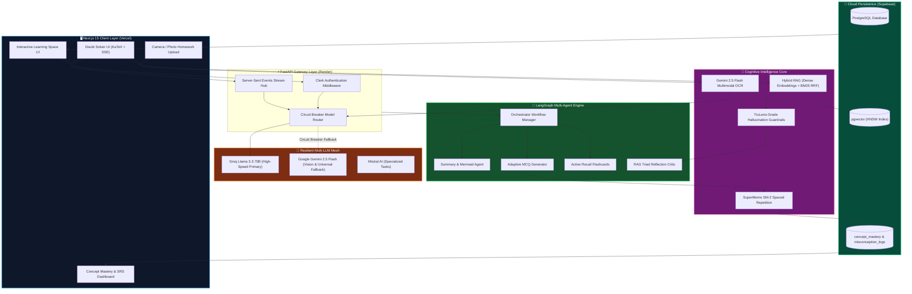

<div align="center">

<!-- Animated Header Banner -->


<!-- Dynamic Real-Time Typing Animation -->
<a href="https://smart-tutor-ai-tan.vercel.app/">
  
</a>

<br/>

<!-- Live Status & Deployment Badges -->
<p align="center">
  <a href="https://smart-tutor-ai-tan.vercel.app/" target="_blank">
    
  </a>
  <a href="https://smarttutorai.onrender.com/health" target="_blank">
    
  </a>
  <a href="https://github.com/Aditya16703/SmartTutorAI/actions/workflows/ci.yml" target="_blank">
    
  </a>
  
</p>

<!-- Technology & Metric Shields -->
<p align="center">
  <a href="https://github.com/Aditya16703/SmartTutorAI/stargazers">
    
  </a>
  <a href="https://github.com/Aditya16703/SmartTutorAI/network/members">
    
  </a>
  <a href="https://opensource.org/licenses/MIT">
    
  </a>
  
  
  
  
  
  
</p>

<p align="center">
  <a href="https://smart-tutor-ai-tan.vercel.app/"><b>🚀 Launch Live App</b></a> •
  <a href="#-the-7-architectural-breakthroughs"><b>Architectural Breakthroughs</b></a> •
  <a href="#-system-architecture"><b>System Architecture</b></a> •
  <a href="#-smarttutorai-vs-conventional-ai-chatbots"><b>Feature Matrix</b></a> •
  <a href="#-quickstart--local-setup"><b>Quickstart</b></a> •
  <a href="#-api-reference"><b>API Docs</b></a>
</p>

</div>

---

## 🌟 Executive Overview

**SmartTutorAI** is an autonomous, cognitive-science-driven educational intelligence platform. It ingests complex textbooks, research PDFs, YouTube lectures, and raw curriculum topics, transforming them into an adaptive, multi-agent cognitive workspace.

Unlike traditional LLM wrappers that hallucinate calculations and spoon-feed passive answers, **SmartTutorAI** integrates:
- **Mathematical rigor** via native KaTeX LaTeX engines.
- **Academic honesty** through TruLens-style RAG Triad hallucination critics.
- **Socratic scaffolding** that trains students to think rather than copy.
- **Spaced repetition (SuperMemo SM-2)** that guarantees long-term retention.
- **Multimodal vision OCR** that can read and solve handwritten homework assignments step-by-step.

---

## ⚡ The 7 Architectural Breakthroughs

<table>
  <tr>
    <td width="50%" valign="top">
      <h3>🔍 1. Hybrid Vector RAG with Deep Citations</h3>
      <p>Blends <b>dense vector embeddings</b> (Google <code>text-embedding-004</code>) with <b>BM25 lexical search</b> via <b>Reciprocal Rank Fusion (RRF)</b>.</p>
      <ul>
        <li>Exact character-offset page boundary mapping for PDFs.</li>
        <li>Sub-second timestamped video deep links for YouTube lectures (<code>&t=154s</code>).</li>
        <li>Interactive citation pills in the UI that open sources directly.</li>
      </ul>
    </td>
    <td width="50%" valign="top">
      <h3>⚡ 2. Real-Time Token Streaming (SSE)</h3>
      <p>Ultra-low-latency <b>Server-Sent Events (SSE)</b> token streaming via FastAPI async generators.</p>
      <ul>
        <li>Sub-200ms Time-To-First-Token (TTFT) response latency.</li>
        <li>Asynchronous typewriter animation in the Next.js UI.</li>
        <li>Graceful multi-turn history persistence to Supabase.</li>
      </ul>
    </td>
  </tr>
  <tr>
    <td width="50%" valign="top">
      <h3>🛡️ 3. RAG Triad Anti-Hallucination Critic</h3>
      <p>Automated reflection evaluator grading every generated response on 3 orthogonal axes:</p>
      <ul>
        <li><b>Context Relevance (0-100%)</b>: Did retrieval surface what was needed?</li>
        <li><b>Anti-Hallucination Groundedness (0-100%)</b>: Are claims strictly proven by notes?</li>
        <li><b>Answer Relevance (0-100%)</b>: Does it solve the student's doubt?</li>
      </ul>
      <p>Displays an interactive trust badge: <code>🛡️ Verified Grounded in Source (96%)</code>.</p>
    </td>
    <td width="50%" valign="top">
      <h3>📐 4. Native KaTeX LaTeX Formula Engine</h3>
      <p>End-to-end mathematical typography engine built with <code>remark-math</code> & <code>rehype-katex</code>.</p>
      <ul>
        <li>Inline math: <code>$E = mc^2$</code>, <code>$\vec{F} = m\vec{a}$</code>.</li>
        <li>Display block calculus & physics derivations:
          <br/>$$\int_0^\infty e^{-x^2} dx = \frac{\sqrt{\pi}}{2}$$
        </li>
        <li>One-click code headers with copy-to-clipboard functionality.</li>
      </ul>
    </td>
  </tr>
  <tr>
    <td width="50%" valign="top">
      <h3>🏛️ 5. Socratic 3-Tier Progressive Scaffolding</h3>
      <p>Toggle between <b>Direct Explanations</b> and <b>Socratic Mentorship</b> with progressive hints:</p>
      <ul>
        <li>🥉 <b>Tier 1: Nudge</b> — Conceptual cue without revealing equations.</li>
        <li>🥈 <b>Tier 2: Clue</b> — Core theorem, formula setup, and tactical strategy.</li>
        <li>🥇 <b>Tier 3: Solution</b> — Complete step-by-step resolution.</li>
      </ul>
    </td>
    <td width="50%" valign="top">
      <h3>📊 6. Concept Mastery Graph & SM-2 SRS</h3>
      <p>Cognitive retention engine modeling the human forgetting curve:</p>
      <ul>
        <li><b>EWMA Mastery Score</b>: Tracks student readiness score ($0 - 100\%$).</li>
        <li><b>SuperMemo SM-2</b>: Computes optimal spacing intervals ($I_n$) and ease factors ($EF$).</li>
        <li><b>AI Misconception Diagnostic</b>: Analyzes incorrect quiz options to pinpoint exact cognitive fallacies.</li>
      </ul>
    </td>
  </tr>
  <tr>
    <td colspan="2" valign="top">
      <h3>📷 7. Multimodal Gemini 2.5 Vision Homework Solver</h3>
      <p>Snap a photo of handwritten math calculations, chemistry mechanisms, or physics circuit diagrams. Powered by <b>Google Gemini 2.5 Flash Vision OCR</b>:</p>
      <ul>
        <li>Transcribes handwritten equations, geometric figures, and scientific notation cleanly into LaTeX.</li>
        <li>Provides a rigorous step-by-step mathematical proof formatted with KaTeX display blocks.</li>
        <li>Generates a targeted <b>Socratic Self-Test</b> follow-up question to verify authentic conceptual mastery.</li>
        <li>Automatically logs problem solutions into the student's active workspace history.</li>
      </ul>
    </td>
  </tr>
</table>

---

## ⚖️ SmartTutorAI vs Conventional AI Chatbots

| Capability | 🤖 Standard ChatGPT / Wrapper | 🎓 SmartTutorAI |
| :--- | :---: | :---: |
| **Source Grounding** | ❌ Hallucinates unverified claims | ✅ **Hybrid Vector RAG (pgvector + BM25 RRF)** |
| **Precise Citations** | ❌ Vague or non-existent | ✅ **Exact PDF Page Numbers & YouTube Timestamps** |
| **Anti-Hallucination Guardrails**| ❌ Zero reflection or verification | ✅ **RAG Triad Live Telemetry (Groundedness %)** |
| **Mathematical Typesetting** | ⚠️ Broken raw markdown or ASCII | ✅ **Native KaTeX LaTeX inline & block rendering** |
| **Pedagogical Strategy** | ❌ Spoon-feeds answers instantly | ✅ **Socratic 3-Tier Progressive Scaffolding** |
| **Cognitive Retention** | ❌ Amnesic (no spaced repetition) | ✅ **SuperMemo SM-2 Interval Scheduling** |
| **Diagnostic Feedback** | ❌ "Incorrect, answer is B" | ✅ **AI Misconception Diagnostic & Remediation** |
| **Multimodal Problem Solving**| ⚠️ Generic image captions | ✅ **Full Handwritten Vision OCR & LaTeX Derivation** |
| **Inference Reliability** | ⚠️ Hard-crashes on provider outages | ✅ **Circuit-Breaker Multi-LLM Routing (Groq + Gemini)** |

---

## 🏗️ System Architecture



---

## 🔬 Mathematical Formulations

<details>
<summary><b>📐 Click to Expand: SuperMemo SM-2 Spaced Repetition Equations</b></summary>
<br/>

The spacing interval $I(n)$ is determined after each review session using the student's performance quality rating $q \in \{0, 1, 2, 3, 4, 5\}$:

$$I(n) = \begin{cases} 
1 \text{ day}, & \text{if } n = 1 \\ 
6 \text{ days}, & \text{if } n = 2 \\ 
I(n-1) \times EF, & \text{if } n > 2 
\end{cases}$$

Where the **Easiness Factor** ($EF$) updates dynamically according to:

$$EF' = \max\left(1.3,\; EF + \left(0.1 - (5 - q) \times (0.08 + (5 - q) \times 0.02)\right)\right)$$

If a student scores $q < 3$ (failure), the repetition sequence resets to $n = 0$ and $I = 1\text{ day}$, ensuring immediate re-consolidation.
</details>

<details>
<summary><b>🔍 Click to Expand: Reciprocal Rank Fusion (RRF) Retrieval</b></summary>
<br/>

To synthesize dense semantic similarity with sparse keyword precision, retrieved candidates are re-ranked using:

$$RRF\_Score(d) = \sum_{m \in M} \frac{1}{k + r_m(d)}$$

Where:
- $M = \{\text{Dense Vector Retrieval}, \text{BM25 Full-Text Retrieval}\}$
- $k = 60$ (smoothing constant preventing top-rank bias)
- $r_m(d)$ is the ordinal rank of document chunk $d$ in system $m$.
</details>

<details>
<summary><b>🛡️ Click to Expand: RAG Triad Evaluation Matrix</b></summary>
<br/>

Every answer generates a composite verification score:

$$\text{Overall Trust} = 0.45 \times \text{Groundedness} + 0.30 \times \text{Context Relevance} + 0.25 \times \text{Answer Relevance}$$

- **$\ge 75\%$**: Marked `🛡️ Verified Grounded in Source` (Green).
- **$45\% - 74\%$**: Marked `⚡ Partially Grounded` (Amber).
- **$< 45\%$**: Marked `🌐 General Knowledge Tutor` (Blue).
</details>

---

## 🗂️ Project Directory Structure

```plaintext
SmartTutorAI/
├── backend/
│   ├── main.py                         # FastAPI application entry point & CORS
│   ├── test_edge_cases.py              # Automated regression test suite
│   ├── requirements.txt                # Python dependencies
│   ├── src/
│   │   ├── api/routes/
│   │   │   ├── doubt.py                # Real-time SSE token stream & RAG routes
│   │   │   ├── mastery.py              # SM-2 mastery & misconception diagnostic API
│   │   │   ├── vision.py               # Multimodal Gemini homework solver API
│   │   │   ├── workflow.py             # LangGraph workspace generation
│   │   │   └── orchestrator.py         # Async job management
│   │   ├── services/
│   │   │   ├── rag_service.py          # Hybrid RAG, BM25 & chunking engine
│   │   │   ├── guardrail_service.py    # RAG Triad hallucination critic
│   │   │   ├── mastery_service.py      # SuperMemo SM-2 & EWMA calculation
│   │   │   ├── vision_service.py       # Multimodal OCR & LaTeX solver
│   │   │   └── supabase_service.py     # Supabase client & query persistence
│   │   └── utils/
│   │       ├── model_router.py         # Circuit Breaker multi-LLM router
│   │       ├── pdf_extractor.py        # PDF character-offset page mapper
│   │       └── youtube_extractor.py    # Subtitle segment & timestamp parser
├── frontend/
│   ├── package.json                    # Next.js 15.5, Tailwind v4 & KaTeX
│   ├── src/
│   │   ├── app/
│   │   │   ├── learn/[id]/
│   │   │   │   ├── page.tsx            # Learning space workspace page
│   │   │   │   ├── _components/
│   │   │   │   │   ├── doubt-solver.tsx    # SSE streaming chat, vision & guardrails
│   │   │   │   │   ├── citation-pills.tsx  # Deep-link video & PDF citations
│   │   │   │   │   └── concept-mastery.tsx # Spaced repetition telemetry widget
│   │   │   │   └── quiz/_components/
│   │   │   │       └── quiz-section.tsx    # Quiz UI with misconception diagnostics
│   │   └── components/
│   │       └── markdown-renderer.tsx   # KaTeX LaTeX math markdown engine
├── rag_schema.sql                      # Supabase pgvector HNSW chunk tables & RPC
└── mastery_schema.sql                  # Supabase SM-2 concept mastery schema
```

---

## 🚀 Quickstart & Local Setup

### 1. Clone Repository
```bash
git clone https://github.com/Aditya16703/SmartTutorAI.git
cd SmartTutorAI
```

### 🐳 Option A: Run with Docker Compose (Recommended - 1 Command)
Spin up both the FastAPI backend and Next.js frontend in isolated multi-stage containers:
```bash
# Copy env templates
cp backend/.env.example backend/.env
cp frontend/.env.example frontend/.env

# Build and start all services
docker compose up --build
```
- **Frontend**: `http://localhost:3000`
- **Backend API**: `http://localhost:8000` (`/docs` for interactive Swagger UI)
- **Healthcheck**: `http://localhost:8000/health`

---

### 💻 Option B: Manual Local Setup

#### Step 1: Database Setup (Supabase)
In your [Supabase Dashboard](https://supabase.com/dashboard) ➔ **SQL Editor**, execute:
1. [`rag_schema.sql`](./rag_schema.sql) (creates `document_chunks` table, HNSW vector index, and `hybrid_search` RPC function).
2. [`mastery_schema.sql`](./mastery_schema.sql) (creates `concept_mastery`, `misconception_logs`, and SM-2 functions).

#### Step 2: Backend Setup (FastAPI)
```bash
cd backend
python -m venv venv

# Windows
.\venv\Scripts\activate
# Linux/macOS
source venv/bin/activate

pip install -r requirements.txt
python -m uvicorn main:app --host 127.0.0.1 --port 8000 --reload
```
*Backend live at `http://localhost:8000` (`/docs` for Swagger UI).*

#### Step 3: Frontend Setup (Next.js 15)
```bash
cd frontend
npm install
npm run dev
```
*Frontend live at `http://localhost:3000`.*

---

## 📡 API Reference

| Method | Endpoint | Description |
| :--- | :--- | :--- |
| `POST` | `/api/doubt/stream` | Server-Sent Events (SSE) token stream with citations & guardrails |
| `POST` | `/api/doubt/ask` | Synchronous doubt resolution with full RAG Triad telemetry |
| `POST` | `/api/vision/solve-homework` | Multimodal Gemini Vision OCR & step-by-step LaTeX derivation |
| `POST` | `/api/mastery/record-attempt` | Updates SM-2 spaced repetition interval, ease factor, and EWMA score |
| `POST` | `/api/mastery/diagnose` | Diagnoses student cognitive misconception on incorrect quiz options |
| `GET` | `/api/mastery/breakdown/{space_id}/{user_id}` | Returns concept-by-concept readiness and retention breakdown |
| `GET` | `/api/doubt/rag-status/{space_id}` | Checks indexed document chunk count and source format availability |
| `GET` | `/health` | Cloud provider liveness probe (`{"status":"healthy"}`) |

---

## 🌐 Production Deployment

- **Frontend (Vercel)**: [https://smart-tutor-ai-tan.vercel.app/](https://smart-tutor-ai-tan.vercel.app/)
- **Backend (Render)**: [https://smarttutorai.onrender.com](https://smarttutorai.onrender.com/health)
- **Database (Supabase)**: PostgreSQL with `pgvector` & HNSW indexing
- **Continuous Keep-Alive**: Active cron-job pinging `/health` every 10 minutes to guarantee 0 cold starts

---

## 📈 GitHub Star History

<div align="center">
  <a href="https://star-history.com/#Aditya16703/SmartTutorAI&Date">
    <picture>
      <source media="(prefers-color-scheme: dark)" srcset="https://api.star-history.com/svg?repos=Aditya16703/SmartTutorAI&type=Date&theme=dark" />
      <source media="(prefers-color-scheme: light)" srcset="https://api.star-history.com/svg?repos=Aditya16703/SmartTutorAI&type=Date" />
      
    </picture>
  </a>
</div>

---

## 🤝 Contributing

Contributions are welcome! If you would like to contribute:
1. Fork the Project (`https://github.com/Aditya16703/SmartTutorAI/fork`)
2. Create your Feature Branch (`git checkout -b feature/AmazingFeature`)
3. Commit your Changes (`git commit -m 'feat: Add AmazingFeature'`)
4. Push to the Branch (`git push origin feature/AmazingFeature`)
5. Open a Pull Request

---

## 📄 License

Distributed under the **MIT License**. See [`LICENSE`](./LICENSE) for full details.

<div align="center">
  <sub>Engineered with ❤️ by <a href="https://github.com/Aditya16703">Aditya</a> and the SmartTutorAI open-source community.</sub>
</div>
